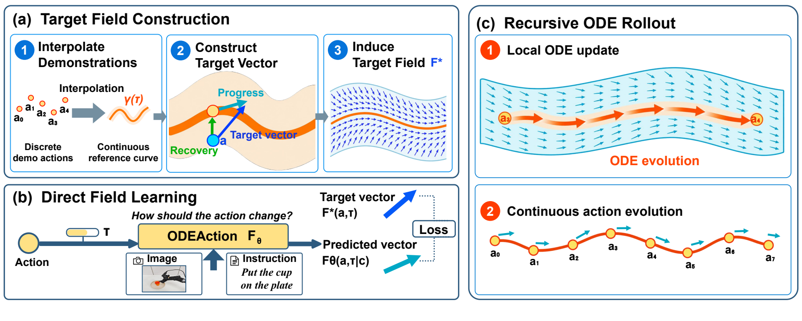

<h1 align="center">ODEAction:<br>From Predicting Chunks to Evolving Actions</h1>

<p align="center">
  Qishen Wang<sup>1,2</sup>,
  Pengxiang Ding<sup>1,3,4‡</sup>,
  Shifeng Bao<sup>5</sup>,
  Mingyang Sun<sup>1,3,4</sup>,
  Hengtao Li<sup>1</sup>,
  Yi Gao<sup>1</sup>,
  Baohua Yin<sup>1</sup>,
  Yang Liu<sup>4</sup>,
  Jiajun Fu<sup>1,6</sup>,
  Jiacheng Liu<sup>1,3,4</sup>,
  Changjing He<sup>1,6</sup>,
  Peiyang Li<sup>1,7</sup>,
  Runze Suo<sup>8</sup>,
  Yan Wang<sup>6</sup>,
  Xiaobo Wang<sup>9</sup>,
  Yonghao Dang<sup>10</sup>,
  Cheng Chi<sup>5*</sup>
</p>

<p align="center"><sup>‡</sup> Project Lead · <sup>*</sup> Corresponding Author</p>

<details align="center">
<summary>Affiliations</summary>
<p>
  <sup>1</sup> Symbiosis Robotics<br>
  <sup>2</sup> University of Science and Technology of China<br>
  <sup>3</sup> Zhejiang University<br>
  <sup>4</sup> Westlake University<br>
  <sup>5</sup> Renmin University of China<br>
  <sup>6</sup> Tsinghua University<br>
  <sup>7</sup> Beijing University of Posts and Telecommunications<br>
  <sup>8</sup> Fudan University<br>
  <sup>9</sup> Shenzhen University of Advanced Technology<br>
  <sup>10</sup> Central University of Finance and Economics
</p>
</details>

<p align="center">
  <a href="https://arxiv.org/abs/2611.09672"><b>Paper</b></a> ·
  <a href="https://wang-qishen.github.io/odeaction-website/"><b>Project Page</b></a> ·
  <a href="docs/real_robot.md"><b>Real-Robot Guide</b></a>
</p>

**ODEAction shifts action generation from predicting chunks to evolving actions.** It learns an action transition field that describes how the current action should change, conditioned on visual observations, a task instruction, and robot proprioceptive information. Demonstrations supervise this field, and ODE integration turns its predictions into a sequence of actions.

<p align="center">
  <a href="docs/figures/figure2.png"></a>
</p>

**Method overview.** **(a)** Interpolate demonstrations and construct a target field combining progression and correction. **(b)** Directly train the policy to predict the target transition vectors. **(c)** Integrate the learned field to recursively generate actions. See the [method explanation](docs/method.md) for details.

## Get Started

This repository provides an [openpi](https://github.com/Physical-Intelligence/openpi)-based JAX implementation of ODEAction for real-world robot learning, with π₀.₅ training and Cobot Magic deployment examples.

- **Training:** π₀.₅ and ODEAction support multi-task learning with full fine-tuning or VLM-LoRA.
- **Inference:** Euler and RK4 use the same trained weights, with configurable integration substeps.
- **Deployment:** a policy server and robot client exchange observations and actions, with execution feedback and session reset.

To train and deploy ODEAction on real-world robots, follow the [**Cobot Magic example**](docs/real_robot.md).

## Citation

If you find this work useful, please cite:

```bibtex
@misc{wang2026odeaction,
  title         = {ODEAction: From Predicting Chunks to Evolving Actions},
  author        = {Wang, Qishen and Ding, Pengxiang and Bao, Shifeng and
                   Sun, Mingyang and Li, Hengtao and Gao, Yi and Yin, Baohua and
                   Liu, Yang and Fu, Jiajun and Liu, Jiacheng and He, Changjing and
                   Li, Peiyang and Suo, Runze and Wang, Yan and Wang, Xiaobo and
                   Dang, Yonghao and Chi, Cheng},
  year          = {2026},
  eprint        = {2611.09672},
  archivePrefix = {arXiv},
  primaryClass  = {cs.RO}
}
```

## Acknowledgments

We thank Physical Intelligence for [openpi](https://github.com/Physical-Intelligence/openpi). This implementation builds on upstream commit [`650c5b0`](https://github.com/Physical-Intelligence/openpi/commit/650c5b0283a49c42784fb5055a0507da2c6d347d). The original [Apache-2.0 license](LICENSE) and [Gemma license](LICENSE_GEMMA.txt) are retained.
